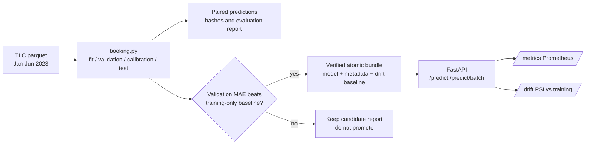

# Taxi Trip Duration Service

[](https://github.com/VasilenData/taxi-eta-service/actions/workflows/ci.yml)

A booking-time trip-duration model with a validated REST API, independent interval calibration, a versioned model bundle, drift monitoring, Docker and CI. The default model uses pickup/drop-off zones, pickup hour and weekday, and passenger count; it does not require recorded trip distance.

**Verified 11 November 2026: 4.07-minute MAE on 200,000 held-out June 2023 trips, versus 5.57 minutes for a training-only route/hour/global median baseline (27.02% lower).** May-calibrated nominal 80% intervals covered 80.59% of June targets, with mean width 14.21 minutes. These are bounded samples of eligible completed TLC trips, not live traffic or production performance. [Inspect the report and every paired prediction](reports/booking-2023-h1/index.html).



## Why this is more than a notebook

| Concern | What is built |
|---|---|
| **Current evaluation workflow** | Fit January-March, early-stop and qualify on April, calibrate on May, report June once. Source-row identities and completed-label cutoffs enforce phase boundaries. |
| **A baseline to beat** | Train-only route median with minimum support 20, falling back to hourly/global medians. Validation MAE qualifies the learned candidate; final test never controls promotion. |
| **Reproducibility** | MLflow run per training (params, metrics, model files). Current training hashes ordered input values, schema and dtypes, and records a separate SHA-256 of the trained model. Legacy stored artifacts retain their original configuration-only fingerprints. The booking workflow additionally hashes source files, phase frames and code. |
| **Safe model updates** | Atomic model/metadata bundle; the measured booking bundle is promoted byte-for-byte to the default registry. Its validation gate is a baseline comparison. The separate legacy workflow retains champion/challenger tests. |
| **API contract** | Pydantic validation on every field: zone ids 1 to 265, passengers 1 to 6; optional legacy distance 0.1 to 100 miles, NYC local wall-clock ISO timestamps without an offset. Invalid-input cases return 422. Batch limited to 1,000. |
| **Uncertainty** | A separate May sample calibrates error-ratio intervals. June coverage is 80.59% for nominal 80%; coverage under future shift is not guaranteed. |
| **Operations** | `/health`, `/ready` (503 until a model loads), `/metrics` in Prometheus format, `/model` returns the model card numbers, Docker image runs as a non-root user, compose file adds Prometheus. |
| **Drift monitoring** | `/drift` computes the Population Stability Index per feature over recent requests. See the model card for measured values. |
| **Tests and CI** | Tests cover data cleaning, split isolation, model behavior, API validation, drift and champion/challenger selection. CI lints, tests, loads the committed model, load-tests the real server and builds and calls the Docker image. |

## Booking-time model and independent calibration

A separate [booking workflow](docs/BOOKING.md) excludes recorded trip distance entirely. It trains on January–March,
uses April only for early stopping and the baseline gate, calibrates uncertainty on May, and assesses June once.
Only pickup/drop-off zones, pickup hour, weekday and passenger count enter the model. A training-only route-median
baseline falls back to hourly/global medians for sparse or unseen routes.

The command writes paired per-trip predictions, source/frame/model/code hashes, failure slices and a static report.
Its learned model is eligible for the separate `models/booking` registry only if validation MAE beats the baseline;
June test results never control that gate. The [dated report](reports/booking-2023-h1/index.html) records the measured booking-model results. The historical distance-assisted experiment below remains separate from these booking-time results.

```bash
PYTHONPATH=src python -m tripeta.booking --data-dir /path/to/taxi \
  --output reports/local-booking-run --registry models/booking \
  --train-sample 100000 --evaluation-sample 200000 --seed 42
TRIPETA_MODEL_DIR=models/booking PYTHONPATH=src uvicorn tripeta.api:app --port 8000
```

With a booking model loaded, `/predict` accepts requests without `distance_miles` and ignores that field if supplied.
Legacy distance models still reject missing distance with HTTP 422. Prediction and drift feature lists follow the
loaded booster, and model versions use the model-content hash when available.

## Try it

```bash
pip install -r requirements-dev.txt
PYTHONPATH=src uvicorn tripeta.api:app --port 8000

curl -s localhost:8000/predict -H 'content-type: application/json' \
  -d '{"pickup_zone":161,"dropoff_zone":237,"pickup_time":"2023-06-14T18:30:00","passengers":1}'
# {"predicted_minutes":..., "low_minutes":..., "high_minutes":..., "model_version":"taxi-booking-duration-f7e0d7de3f1b"}

pytest -q                                   # regression and sample-model tests
docker compose up --build                   # API on :8000, Prometheus on :9090
```

The separate historical distance-assisted training workflow remains available; use a separate candidate registry:

```bash
PYTHONPATH=src python -m tripeta.train --data-dir /path/to/taxi --train 2023-01..2023-08 --valid 2023-09 --test 2023-10 --registry models/legacy-candidate
```

## Historical distance-assisted experiment

October 2023 evaluation on 3.35 million trips recorded MAE 3.52 minutes versus 9.33 for a distance-and-speed baseline.
It used realized taximeter distance and an older test-driven promotion rule, so it is not booking-time accuracy evidence.
The original `models/current/model.txt` and `metadata.json` remain unchanged for inspection; the new `bundle.json` takes
precedence for serving. [Historical model card](docs/MODEL_CARD.md).

## Historical serving performance

These measurements predate the booking model. Real uvicorn server, real HTTP, one `/predict` call per request, same 17-core VM as historical training (`python scripts/loadtest.py`). The load generator is itself Python and shares the machine, so treat throughput as a floor.

| Setup | Throughput | p50 | p95 | p99 |
|---|---|---|---|---|
| 1 worker, 1 client | 235 req/s | 4.0 ms | 5.6 ms | 6.0 ms |
| 1 worker, 16 clients | 251 req/s | 62 ms | 91 ms | 113 ms |
| 4 workers, 16 clients | 384 req/s | 33 ms | 57 ms | 75 ms |

One worker is CPU bound at about 250 requests per second (each request builds a small DataFrame and runs the booster), so latency under 16 clients is mostly queueing. Batch requests (`/predict/batch`) amortise that cost.

## Decisions and limits

- **Distance is an input to the legacy model.** API callers supply it to that model; the separate booking model excludes it. Historical training and evaluation use the taximeter's recorded trip distance; no route planner is integrated, and accuracy with a planned-route estimate at booking has not been evaluated.
- **LightGBM for tabular inputs.** The recorded booking fit took 5.00 seconds with four threads in this run; that excludes loading, verification and report generation. Historical serving timings above have not been repeated for this model.
- **File registry, not a registry server.** `models/current` plus MLflow runs is enough for one model. The champion/challenger rule is the part that matters, and it is separate from the storage.
- **Drift needs traffic.** `/drift` returns `insufficient_data` until 200 requests have arrived, and keeps the last 5,000 in memory only. A production setup would write requests to a log or topic.
- **Railway trial demo.** [API documentation](https://taxi-booking-api-demo.up.railway.app/docs) is publicly hosted on a Railway trial. A [dated probe on 11 November 2026](https://vasilendata.github.io/labs/service/probe-2026-11-11.json) observed four successful endpoint/contract checks, including a distance-free prediction with the verified booking model. This is one observation, not continuous monitoring, a latency percentile or an uptime/SLA claim; trial availability can end. Local and Docker setup remain available.

Full numbers, segments and limits: [docs/MODEL_CARD.md](docs/MODEL_CARD.md).

## One operational observation

```bash
python scripts/probe.py http://localhost:8000 --output reports/probe-latest.json
```

The probe makes four sequential HTTP calls to `/health`, `/ready`, `/model` and `/predict`. It verifies the committed
model hash, booking feature contract, readiness and an ordered prediction interval without supplying distance.
Each call has a five-second timeout and latency budget; a failed observation still writes a timestamped JSON report
and exits nonzero. The manual [probe workflow](.github/workflows/probe.yml) retains the report for 14 days. There is
no schedule, uptime percentage or latency-percentile claim. Source-file and evaluation evidence remain separate.

## Evaluation and API boundaries
Invalid or reversed month ranges fail before loading data. Training, validation and test months must be strictly ordered and non-overlapping. Source paths are parameterized, and rows whose pickup month differs from the requested file month are excluded before sampling.

In the legacy training command, model selection, early stopping and interval calibration share validation data; the final future test month is reserved for reporting. The default booking workflow instead has an independent calibration month. Repeatedly inspecting that report while tuning would still overfit it. The original distance-assisted model files and historical full-data metrics remain unchanged; their earlier promotion policy used the test month. The separate booking model was newly trained and verified as reported above. Sample-based CI tests verify behavior, not the published 3.35-million-trip performance claim.

`pickup_time` must be NYC local wall time without a timezone suffix, matching training features; offset-aware timestamps are rejected instead of silently using the wrong hour. Unknown routes share one metrics label, preventing arbitrary 404 paths from creating unlimited series.

### Atomic local model publication

New saves publish `models/current/bundle.json`: the LightGBM model text and its metadata are serialized together, flushed to a temporary file in the same directory, then selected with an atomic file replacement. Readers load one snapshot, so a failed publication leaves the previous champion intact and cannot pair a new model with old metadata. Non-finite JSON metadata is rejected before publication. Failure-injection and concurrent-reader tests cover these boundaries.

The loader still supports the checked-in `model.txt` / `metadata.json` layout. A bundle takes precedence; a corrupt bundle fails closed rather than silently reverting to an older model. The service loads at startup, so restart it to activate a newly published champion. Serialize training/promotion jobs: this is a single-writer local registry, not a distributed compare-and-swap service or a guarantee against filesystem/hardware failure. Historical model metrics have not been regenerated by this storage change.
