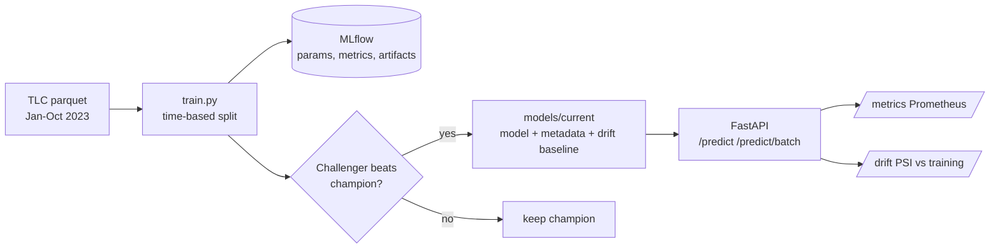

# Taxi Trip Duration Service

[](https://github.com/VasilenData/taxi-eta-service/actions/workflows/ci.yml)

An end-to-end machine learning service: data, training, experiment tracking, a model registry with a promotion rule, a validated REST API, monitoring and drift detection, a container and CI. Predicts how long a NYC yellow-taxi trip will take.

**Historical October 2023 evaluation (3.35 million trips): mean absolute error 3.52 minutes against 9.33 for a distance-and-speed baseline, 62% lower.** The earlier promotion rule used test-month scores; this stored artifact has not been retrained or reevaluated under the current validation-only rule. These figures also use TLC's recorded taximeter distance, not a planned-route estimate available at booking.



## Why this is more than a notebook

| Concern | What is built |
|---|---|
| **Current evaluation workflow** | Train on Jan to Aug, stop early and select on September, report on October. The CLI enforces disjoint chronological month ranges and excludes out-of-period pickup rows. |
| **A baseline to beat** | A distance divided by median hourly speed rule. A test asserts the model beats it. |
| **Reproducibility** | MLflow run per training (params, metrics, model files). A split/row-count configuration fingerprint and feature list are stored; the current fingerprint is not an input-content checksum. |
| **Safe model updates** | Champion/challenger: the registry changes only if the new model wins on the same validation month; test metrics are reporting-only. A test proves a weaker model does not overwrite it. |
| **API contract** | Pydantic validation on every field: zone ids 1 to 265, distance 0.1 to 100 miles, passengers 1 to 6, NYC local wall-clock ISO timestamps without an offset. Invalid-input cases return 422. Batch limited to 1,000. |
| **Uncertainty** | Every prediction returns a range (10th to 90th percentile), calibrated on validation; recorded October coverage was 83.7%. |
| **Operations** | `/health`, `/ready` (503 until a model loads), `/metrics` in Prometheus format, `/model` returns the model card numbers, Docker image runs as a non-root user, compose file adds Prometheus. |
| **Drift monitoring** | `/drift` computes the Population Stability Index per feature over recent requests. See the model card for measured values. |
| **Tests and CI** | Tests cover data cleaning, split isolation, model behavior, API validation, drift and champion/challenger selection. CI lints, tests, loads the committed model, load-tests the real server and builds and calls the Docker image. |

## Try it

```bash
pip install -r requirements-dev.txt
PYTHONPATH=src uvicorn tripeta.api:app --port 8000

curl -s localhost:8000/predict -H 'content-type: application/json' \
  -d '{"pickup_zone":161,"dropoff_zone":237,"pickup_time":"2023-10-14T18:30:00","distance_miles":2.4}'
# {"predicted_minutes":..., "low_minutes":..., "high_minutes":..., "model_version":"taxi-trip-duration-579ee2ae22a7"}

pytest -q                                   # regression and sample-model tests
docker compose up --build                   # API on :8000, Prometheus on :9090
```

Retrain on the full TLC files (the trained model is already committed in `models/current`):

```bash
PYTHONPATH=src python -m tripeta.train --data-dir /path/to/taxi --train 2023-01..2023-08 --valid 2023-09 --test 2023-10
```

## Measured serving performance

Real uvicorn server, real HTTP, one `/predict` call per request, same 17-core VM as training (`python scripts/loadtest.py`). The load generator is itself Python and shares the machine, so treat throughput as a floor.

| Setup | Throughput | p50 | p95 | p99 |
|---|---|---|---|---|
| 1 worker, 1 client | 235 req/s | 4.0 ms | 5.6 ms | 6.0 ms |
| 1 worker, 16 clients | 251 req/s | 62 ms | 91 ms | 113 ms |
| 4 workers, 16 clients | 384 req/s | 33 ms | 57 ms | 75 ms |

One worker is CPU bound at about 250 requests per second (each request builds a small DataFrame and runs the booster), so latency under 16 clients is mostly queueing. Batch requests (`/predict/batch`) amortise that cost.

## Decisions and limits

- **Distance is an input.** API callers supply it. Historical training and evaluation use the taximeter's recorded trip distance; no route planner is integrated, and accuracy with a planned-route estimate at booking has not been evaluated.
- **LightGBM, not a neural network.** On tabular data with a few categorical columns it trains in 31 seconds and serves in milliseconds. A neural network would add cost without a clear gain here.
- **File registry, not a registry server.** `models/current` plus MLflow runs is enough for one model. The champion/challenger rule is the part that matters, and it is separate from the storage.
- **Drift needs traffic.** `/drift` returns `insufficient_data` until 200 requests have arrived, and keeps the last 5,000 in memory only. A production setup would write requests to a log or topic.
- **Not deployed to a cloud.** It runs locally and in Docker.

Full numbers, segments and limits: [docs/MODEL_CARD.md](docs/MODEL_CARD.md).

## Evaluation and API boundaries
Invalid or reversed month ranges fail before loading data. Training, validation and test months must be strictly ordered and non-overlapping. Source paths are parameterized, and rows whose pickup month differs from the requested file month are excluded before sampling.

Model selection and early stopping share validation data; the final future test month is reserved for reporting. Repeatedly inspecting that report while tuning would still overfit it. The committed model and historical full-data metrics were not retrained by this review, and the earlier promotion policy used the test month. Sample-based CI tests verify behavior, not the published 3.35-million-trip performance claim.

`pickup_time` must be NYC local wall time without a timezone suffix, matching training features; offset-aware timestamps are rejected instead of silently using the wrong hour. Unknown routes share one metrics label, preventing arbitrary 404 paths from creating unlimited series. The file registry remains a local demonstration; multi-file promotion is not an atomic production registry.
